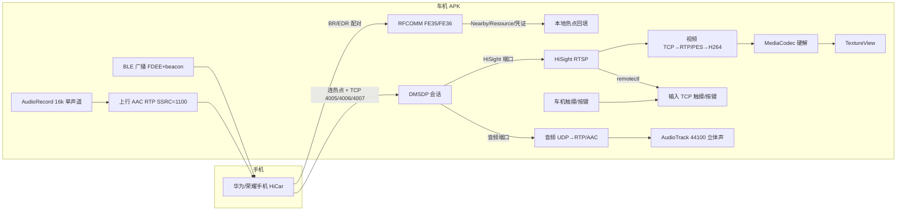

# Android 车机移植设计（海豹06 / DiLink / 骁龙8155）

> 目标：将 HelloCar（Linux 无线 HiCar 接收端，Rust）移植为可在比亚迪海豹06 车机（Android，骁龙 8155，DiLink 可装第三方 APK）运行的 APK，让华为/荣耀手机通过 HiCar 直连车机。
> 本文基于 `HiCar 协议解析.md`（源码实证 + 行号），设计每一层的 Android 映射、构建链、里程碑与风险。标注 **未验证/需实测** 处表示源码无法确认，必须在真机验证阶段确认。

---

## 1. 总体架构

### 1.1 App 结构

```
海豹06 HiCar APK（单 APK，minSdk 29 / targetSdk 34）
├── Kotlin 平台层（App 主线程 + 各平台线程）
│   ├── MainActivity / CarUiService（前台服务，开机自启）
│   ├── BleAdvertiser（BluetoothLeAdvertiser 广播）
│   ├── RfcommServer（BluetoothServerSocket：FE35/FE36）
│   ├── PairingBridge（系统配对流程驱动）
│   ├── LocalHotspotManager（LocalOnlyHotspot + 真实参数回填）
│   ├── VideoSink（MediaCodec 硬解 + TextureView）
│   ├── AudioSink / AudioSource（AudioTrack / AudioRecord）
│   ├── TouchBridge（触摸/按键事件 → 归一化坐标 → 输入报文）
│   └── JniBridge（jni -> libhellocar_android.so）
├── Rust 协议核：libhellocar_android.so（aarch64-linux-android）
│   └── src/hicar/ 移植：wire.rs / dmsdp.rs / hisight.rs / media.rs /
│       session.rs（Nearby+Resource）/ live.rs（媒体编解码与输入）/ uplink.rs / crypto.rs
│       —— 移除：radio.rs 的 BlueZ/NetworkManager 部分、backend.rs 的多进程 IPC、
│          cli.rs 的 worker 入口、native.rs 的 libloading 动态加载
├── C 认证库：libhellocar_hichain.so（aarch64-linux-android）
│   └── deviceauth_lite + huks_lite + securec + compat.c（OpenSSL EVP）
└── jniLibs/arm64-v8a/…（两个 .so + 预编译 OpenSSL/cJSON/mbedTLS 静态库）
```

### 1.2 线程模型（替代原多进程 IPC）

原实现是 **owner + radio/session/media 三个 worker 进程**，通过私有 `SOCK_SEQPACKET` socketpair + JSON 通信（`cli.rs:72-79`、`backend.rs:157`）。Android 单进程内用线程等价替换：

| 原进程 | Android 线程 | 说明 |
| --- | --- | --- |
| owner（backend.rs） | `ProtocolThread`（单线程事件循环） | 持有所有连接与状态机；用 `HandlerThread`/`Looper` 或自制 poll 循环 |
| radio-worker | 由 Kotlin 平台层替代 | BLE/RFCOMM/热点全部走 Android API，不再有 BlueZ/NetworkManager D-Bus |
| session-worker（Nearby/Resource/认证） | `SessionThread` | 合并进协议核；HiChain 用 Rust→JNI 直接调用（替代 libloading + 子进程） |
| media-worker（live.rs） | `MediaThread` | 视频/音频/输入；AAC 编解码改 MediaCodec（替代 ffmpeg 子进程） |
| 本地消费者 socket | 直接函数调用 | 原 Unix socket + kind 1-130 记录协议保留为**内部接口**（JNI 回调）或直接映射 |

关键改造点：
- `backend.rs` 中 `Rpc::new("media-worker"...)` 等进程间 JSON 调用 → 协议核内直接函数调用或 `mpsc` 通道。
- `native.rs` 用 `libloading` 加载 `.so`（`native.rs:99-101`）→ Android 上用 JNI `dlopen` 等价；或直接把认证调用走 JNI 到 `libhellocar_hichain.so`。
- 帧/线程安全：原 `Scope`/回调模式（`native.rs:154`）保持单线程串行调用即可。

### 1.3 数据流图



---

## 2. 每层 Android 映射方案

### 2.1 BLE 广播 → BluetoothLeAdvertiser

**原实现**（`radio.rs:225,38`）：BlueZ `LEAdvertisement1`，`ServiceData[FDEE] = beacon(model, seq) = [1,1,1,3,b0,b1,b2,4,b3,16,seq]`，LocalName `HelloCar`，TxPower 11。

**Android 映射**：
```kotlin
val data = AdvertiseData.Builder()
    .setIncludeDeviceName(true)              // LocalName "HelloCar"
    .addServiceUuid(ParcelUuid(FDEE))        // 0000fdee-0000-1000-8000-00805f9b34fb
    .addServiceData(ParcelUuid(FDEE), beacon) // 11 字节：01 01 01 03 b0 b1 b2 04 b3 10 seq
    .build()
bleAdvertiser.startAdvertising(settings /*ADV_IND, 可发现*/, data, null, callback)
```
- `model`（8 位 hex）与 `sequence` 由 App 配置/递增（`radio.rs:38`；原 `sequence` 每次广播 +1，`radio.rs:17`）。
- **注意**：Android `AdvertiseData` 的 ServiceData 载荷是"服务数据本身"，与 BlueZ `ServiceData` 字典一致，无需再包 AD 头。
- 权限：`BLUETOOTH_ADVERTISE` + 定位权限；骁龙 8155 DiLink 系统需确认蓝牙可被第三方 App 启用广播（**未验证**——部分车机系统对 BLE 广播有约束）。

### 2.2 RFCOMM 服务端 → BluetoothServerSocket

**原实现**：注册 FE35（NearbyServerSocket，信道 23）与 FE36（NearbyBusinessSocket，信道 24），SDP XML 含 RFCOMM 信道（`radio.rs:39,386-387`）；手机通过 SDP 查询定位信道（车机重连时也 `sdptool search 0xfe35` 解析，`radio.rs:42-55,399`）。

**Android 映射**：
```kotlin
val server35 = adapter.listenUsingRfcommWithServiceRecord("NearbyServerSocket", FE35_UUID)
val server36 = adapter.listenUsingRfcommWithServiceRecord("NearbyBusinessSocket", FE36_UUID)
// 各起一个 accept 线程；每 accept 一个 socket → 交给 ProtocolThread 按 Format::Nearby/Json 处理
```
- Android 系统自动完成 SDP 注册与信道分配；手机按 SDP 查 FE35/FE36 信道 → 与原实现**天然兼容**（这正是 HelloCar 自己重连时做的事）。
- 多连接管理：accept 循环 + 每个连接一个 handler；原 `backend.rs:273` 有 8 连接上限、地址校验（仅接受配对手机 IP——RFCOMM 场景改为校验对端蓝牙地址在已配对列表）。
- **风险**：Android `createInsecureRfcommSocket` vs `listenUsingRfcommWithServiceRecord`——HiCar 手机可能要求链路层加密（原实现 `RequireAuthentication=false`，`radio.rs:387`，即不强制加密），若系统默认强制加密需用 `listenUsingInsecureRfcomm...`（**未验证**手机行为）。

### 2.3 配对 → 系统配对 UI 流程与兼容策略

**原实现**：BlueZ Agent `NoInputNoOutput` 自动确认所有请求（`radio.rs:249-250,381`），链路层配对"免输入"；真正的连接码是 HiChain 的 6 位 PIN（应用层）。

**Android 限制**：普通第三方 App **无法**注册为系统默认蓝牙 Agent、无法自动确认配对弹窗（需系统签名/Shizuku）。策略：

1. **首选（不自动，靠 UI）**：App 引导用户在系统设置里完成与手机的 BR/EDR 配对（`BluetoothDevice.createBond()` 触发系统弹窗，用户点确认）。HiChain PIN 在 App 内显示（6 位数字），用户按华为手机 HiCar 应用提示输入。可行性取决于华为手机 HiCar 是否**要求**蓝牙已配对才进入下一步——大概率要求（蓝牙是 RFCOMM 承载），因此配对环节无法完全自动化。
2. **提权自动确认（可选）**：若车机可 root / 授予 Shizuku，用 `BluetoothHeadset`/`BluetoothA2dp` 之外的反射或系统 API 自动 `setBonding` 确认——代价高、随系统版本漂移，**不建议首版**。
3. **记录配对状态**：复用原 `--peer` 概念（`radio.rs:33`），已配对手机列表持久化，重启后只对已配对设备开放。

> 结论：M2 里程碑（见 §4）中"手机能完成配对进入会话"指 **系统配对弹窗人工确认 + HiChain PIN 自动完成**；全自动配对依赖提权，列为可选优化。

### 2.4 认证 → JNI 调 libhellocar_hichain.so

**原实现**：session-worker 用 `libloading` 加载 `libhellocar_hichain.so`，符号：`get_instance / destroy / receive_data / start_pake / authenticate_peer / hks_register_file_callbacks / hks_register_get_hardware_udid_callback / carlink_abi_size`（`native.rs:89-101`）；ABI 结构体 6 个（`native.rs:89-93`）；HUKS 文件 `info1.data/info2.data/hks_keystore`（`native.rs:40`）；UDID = `sha256(device_id)`（`hichain.py:88-89`）。

**Android 映射**：
- 用 **NDK 交叉编译** C 库为 `libhellocar_hichain.so`（arm64-v8a），JNI 静态注册/动态注册包装 `Runtime::new`（`native.rs:86-101` 的逻辑从 Rust 移到一个薄 JNI C 层，或保持 Rust 用 `dlopen`——**推荐：C 库 + 一个 JNI 包装层，Rust 侧不直接 dlopen**，避免 `libloading` 在 Android 的路径问题）。
- 文件回调：改写到 App 私有目录 `context.filesDir/keys/`（原 `/var/lib/hellocar/keys`，`backend.rs:96`），文件名不变（`info1.data` 等）。
- UDID 回调：`sha256(device_id)` 由 Kotlin/Rust 提供，不再依赖 `/proc` 硬件序列。
- `identity.json`：存 App 私有目录；`device_id` 随机 64hex、PIN 6 位、`name=HelloCar`（`identity.py:17-31`）；线上身份 `sha256(model + BR-MAC)`（`identity.py:43-45`）在首次启动时固化。
- **编译依赖**：原 CMake 依赖 `OpenSSL::Crypto + cjson + mbedcrypto`（`CMakeLists.txt:17-20,30`）——Android 无系统 OpenSSL，需预编译或改用 NDK 自带 BoringSSL 适配（`compat.c` 只用 `EVP_PKEY_ED25519`/`EVP_DigestSign/Verify`，BoringSSL 同样提供）。**推荐**：预编译 OpenSSL 1.1.1/3.x for android（或 minizip 的 openssl-android 脚本），cjson/mbedcrypto 同样交叉编译为静态库链入。
- 移植点明细见 §3.2。

### 2.5 热点 → 关键设计：LocalOnlyHotspot + 真实参数回填

**原实现**（`radio.rs:350-376`）：NetworkManager 建 AP：SSID `HelloCar`、band a、信道 149、5745MHz、WPA2-PSK（32hex 随机）、子网 `192.168.49.1/24`；等待 `type AP && (5745 MHz) && ipv4 ready`；Offer：`ssid/bssid/password/owner_ip=192.168.49.1/client_ip=192.168.49.2/frequency=5745/port=4005`（`radio.rs:376`）；凭证字符串 `{client}##{ssid}\n{bssid}\n{password}\n5745\n1##version:3##{port}##2##hicarApIp:{owner}`（`session.rs:24`）。

**Android 限制**：第三方 App 只能用 `WifiManager.startLocalOnlyHotspot()`——SSID/密码/信道/频段/子网**全部由系统随机**，不可配置。

**核心设计：真实参数回填**。流程：

1. 认证通过后（`authenticated=true`，`backend.rs:273` 门槛）才启动 LocalOnlyHotspot（避免无谓热点）。
2. 热点启动回调 `LocalOnlyHotspotReservation` 成功后：
   - 读取 `SoftApConfiguration`（API 30+）：`getSsid()`、`getPassphrase()`；API 33+ `getBand()`/`getChannel()`；BSSID 用蓝牙 MAC（与原 `radio.rs:375` 读 `/sys/class/net/.../address` 等价——注意：**蓝牙 MAC ≠ 热点 BSSID**，原实现就是拿接口 MAC 当 BSSID 下发；Android 上可用蓝牙地址，**需实测**手机是否校验 BSSID 必须等于热点真实 BSSID，若不校验则任意值均可）。
   - 频点：Android 不直接给 MHz，需按信道查表（149→5745）或 API 34+ 的 `getFrequencyMhz()`（**需实测**车机 API level）。
   - IP：LocalOnlyHotspot 网关一般为 `192.168.43.1/24`（DHCP 随机段）；用 `WifiManager`/`ConnectivityManager` 读热点网关地址；手机 IP 固定为 `网关+1` 或交给 DHCP（原 `client_ip=192.168.49.2` 是**静态约定**——手机是否强制按凭证中的 IP 配置自己，**未验证**；若手机静态配 192.168.49.2 而车机热点在 192.168.43.x，则需在回填时把 owner/client 改为真实子网）。
3. 用真实值构造 `Offer`（`session.rs:12-22` 校验：ssid 1-32、password 8-63、port 1024-65532、owner/client 同网段 `192.168.49.x`——**注意 `session.rs:22` 硬校验 `owner.octets()[..3]==[192,168,49]`，移植时必须去掉该硬编码或改为任意网段**，这是源码级必改点）并生成凭证字符串（`session.rs:24`）下发。
4. 手机侧消费分析（**未验证，基于格式推断**）：凭证含 SSID/BSSID/密码/5745MHz/base端口/hicarApIp。手机解析后：
   - 连接 SSID+密码 → 必做。
   - 频点 5745：手机可能校验"预期 5GHz"或直接忽略（原实现写死 5745，因为频段/信道固定）。
   - 若手机**强校验 5745MHz**：LocalOnlyHotspot 信道随机（常为 6/149 之外），可能连接失败或回退。这是回填方案最大不确定点，**M3 必测项**。
   - `hicarApIp`：手机据此连 `base+0=4005` 等端口。原 `port=4005` 固定，Android 上可继续固定 4005-4007（无冲突即可）。

**备选方案（固定热点）**：
- **系统签名**：用比亚迪 DiLink 系统签名重打包 APK（需拿到系统 platform key，通常不可得）→ 可用 `WifiManager.setWifiApConfiguration()` 固定 SSID/信道。
- **Shizuku 提权**：`startLocalOnlyHotspot` 之外，通过 Shizuku 以 shell 身份调用 `setWifiApEnabled`（Android 8+ 已禁止 shell 直接开 AP，需系统 API 白名单）——**可行性低**。
- **USB 网络共享（RNDIS）**：若车机允许 USB 网络共享，可完全绕开 Wi-Fi 热点（HiCar 也支持 usb_connection，但本实现明确拒绝 USB 握手：`auth_wire.py:113-114` 若 `usb_connection=true` 直接报错）——**不适用**。

> 结论：首版采用 **LocalOnlyHotspot + 真实参数回填**，代价是 SSID/信道/子网随机；风险集中在"手机是否强校验 5745MHz 与 192.168.49.x"（**M3 实测项**）。若失败再评估 Shizuku/系统签名。

### 2.6 视频渲染 → MediaCodec 硬解 + SurfaceView/TextureView

**原实现**：HiSight 媒体 TCP → RTP(PT 96/97/98) → PES 解密 → Annex-B access unit（`media.rs:80-101`、`live.rs:245-252`）；消费者拿 H.264 Annex-B（kind 2，flags 标关键帧），800×480@30（`live.rs:48`）。

**Android 映射**：
- **替换 ffmpeg 解码**：原 `live.rs:112` 用 ffmpeg 解 AAC；视频端 HelloCar 本身**不做 H.264 解码**（直接转发给消费者）。Android 上直接：
  ```kotlin
  val format = MediaFormat.createVideoFormat(MediaFormat.MIMETYPE_VIDEO_AVC, 800, 480)
  codec.configure(format, surface /*TextureView*/, null, 0)
  // 每个 access unit（含 SPS/PPS/IDR 的完整帧）直接 codec.queueInputBuffer
  ```
- **喂入格式**：MediaCodec 接受 Annex-B 字节流；每个 buffer 提交**一个完整访问单元**（保持 `live.rs:252` 的按帧交付）。关键帧（IDR）前丢弃非关键帧（`live.rs:52` wait_key 逻辑保留）。
- **关键帧请求**：`{"type":"keyframe"}` → `link.recover()`（`live.rs:302`）保留；MediaCodec 侧 `FLAG_BUFFER_FLAG_KEY_FRAME` 判断 + 首帧等 IDR。**注意**：原实现不发显式 FIR/PLI，若丢帧后长时间黑屏，需实测是否用 HiSight SET_PARAMETER 触发（§5 协议文档 §5.2）。
- 分辨率适配：HiSight 协商 800×480（`hisight.rs:117`）——海豹06 车机屏通常 1280×720+，用 TextureView + `setTransform`/SurfaceView 缩放；**首版保持 800×480 投屏信号**，显示层拉伸（HiCar 手机端按车机能力出流，改分辨率需改 `his_video_formats` 与 `display1` properties（`hisight.rs:117`、`dmsdp.rs:202`），列为 M5）。

### 2.7 音频 → AudioTrack / AudioRecord

**下行（手机→车机）**：原实现 AAC-ADTS → ffmpeg → PCM 44100 立体声，3528B/块（`live.rs:112,135`；`media.rs:5-33`）。
- **替换方案**：RTP 解包后 ADTS 帧直接喂 `MediaCodec`（AAC 解码器），输出 PCM 交 `AudioTrack`（`AudioFormat 44100/STEREO/ENCODING_PCM_16BIT`，`MODE_STREAM`）。去掉 ffmpeg 子进程（`live.rs:110-115` 替换）。
- 双流（媒体/通话 modemSpeaker）混合：保留 `mix_pcm` 饱和逻辑（`live.rs:379`）；AudioTrack 由 App 控制焦点（AudioFocus）。

**上行（麦克风→手机）**：原实现 16kHz mono s16le → ffmpeg AAC 48k stereo 64k ADTS（`uplink.rs:32`）。
- **替换方案**：`AudioRecord`（16000Hz/MONO/PCM_16BIT）→ `MediaCodec` AAC 编码器（48kHz/stereo/64kbps/ADTS 输出）→ 原有 RTP 封装（SSRC 1100，`uplink.rs:13,66-69`）不变。
- 权限：`RECORD_AUDIO`；车机 DiLink 需确认麦克风可被第三方 App 使用（**未验证**）。

### 2.8 触摸回传 → 触摸事件坐标归一化映射

**原实现**：消费者给 0..1 归一化 → `x*800, y*480` → clamp 799/479 → `media::touch` 11 字节体（`live.rs:316`、`media.rs:73-75`）；按键映射表（`media.rs:77-79`：up/down/left/right/enter/back/home/play_pause/next/previous）。

**Android 映射**：
- `SurfaceView` 上的 `onTouchEvent`：`x/viewWidth → 0..1`、`y/viewHeight → 0..1` → 乘 800/480 → clamp → `touch(action, x, y, elapsed)`。按下=0、移动=2、抬起=1（`media.rs:75`）。
- 物理/虚拟按键：`KeyEvent.KEYCODE_DPAD_UP=19` 等正好与协议键码一致（Android 键码 19/20/21/22/23/4/3/85 与 `media.rs:78` 相同），可直接透传 code。
- 输入帧封装：`[0,0] + u16(len+4) + IV16 + AES-CTR(6×0xFF+body)`（`hisight_input.py:22-26`）——密钥与会话密钥一致（`live.rs:202`）。
- 多指：协议 UIBC 能力只声明单指（`hisight.rs:117` `left_point_down/up/move`）；只上报第一触点（`media-protocol.md:60`）。

---

## 3. 构建链设计（Windows 开发机）

### 3.1 Rust 协议核 → aarch64-linux-android .so

**环境**：
1. `rustup target add aarch64-linux-android`（rustup 1.90 自带该 target）。
2. 安装 `cargo-ndk`：`cargo install cargo-ndk`（或直接手写链接参数）。
3. Android NDK r26/r27（API 29+；用 `-platform android-29`）。

**rust-toolchain.toml**（钉死 1.90.0，`rust-toolchain.toml:1-3`；`Cargo.toml:5 rust-version=1.90`）保持原样即可——cargo-ndk 用同一 toolchain。

**依赖在 Android 的可用性**（`Cargo.toml:13-19`）：

| crate | 版本 | Android 可用性 | 备注 |
| --- | --- | --- | --- |
| `libloading =0.8.9` | `=0.8.9` | **可编译**（dlopen 可用） | 但推荐移除：认证改走 JNI 直调 |
| `serde =1.0.228` | `=1.0.228` | 纯 Rust，可用 | |
| `serde_json =1.0.145` | `=1.0.145` | 纯 Rust，可用 | |
| `libc =0.2.177` | `=0.2.177`（仅 unix） | **可用**（aarch64-linux-android 属 unix） | 需确认所有 `libc::` 符号在 Android bionic 存在（socket/BT 相关代码已移除，剩余网络/文件符号均支持） |

**需要裁剪/修改的源码点**（Rust 侧）：
- `radio.rs`：整个 BlueZ D-Bus / NetworkManager / mgmt / sdptool 层**删除**（Android API 替代）；保留 `beacon()`（`radio.rs:38`）与 Offer 结构（`radio.rs:277,376`）逻辑。
- `backend.rs`：进程 IPC（`Rpc`、socketpair、fd 传递 `backend.rs:157-170`）删除；TCP 监听保留但改为 Kotlin `ServerSocket` 或 Rust std TcpListener（**二选一，建议 Rust 内监听 4005-4007**，Kotlin 只做系统 API）。
- `session.rs`：`session.rs:22` 的 `192.168.49` 网段硬校验删除（LocalOnlyHotspot 网段随机）。
- `native.rs`：`libloading` 改为 C ABI 直调（Rust 侧声明 `extern "C"` 函数，链接 libhellocar_hichain.so）；或全走 JNI。
- `live.rs`：ffmpeg 子进程（`live.rs:110-115`）替换为 MediaCodec JNI 回调；`/dev/urandom`（`uplink.rs:68`、`radio.rs:347`）→ Android 上 bionic 支持 `/dev/urandom`，可保留。
- `cli.rs`：worker 入口删除，只留 `run` 等价入口（JNI `start()`）。

**构建命令**：
```powershell
cargo ndk -t arm64-v8a -o app/src/main/jniLibs -p 29 build --release
# 产物：app/src/main/jniLibs/arm64-v8a/libhellocar_android.so
```

### 3.2 C 认证库 → libhellocar_hichain.so

**源文件清单**（pinned commits，`native/sources.json:2-4`）：
- `security_deviceauth@552edb5/frameworks/deviceauth_lite/source/**/*.c`（auth_info/、base/、huks_adapter/、json/、key_agreement/、log/、schedule/、struct/、hichain.c）
- `security_huks@89f0842/frameworks/huks_lite/source/hw_keystore_sdk/**/*.c`（common/、soft_service/、hks_access.c、hks_client.c）
- `third_party_bounds_checking_function@ebef58f/src/*.c`（securec）
- `compat.c`（ED25519 适配 + ABI 守卫，`native/compat.c:7-54`）

**NDK 交叉编译**（CMake + NDK toolchain）：
```powershell
cmake -S native -B build-android ^
  -DCMAKE_TOOLCHAIN_FILE=$env:ANDROID_NDK_HOME/build/cmake/android.toolchain.cmake ^
  -DANDROID_ABI=arm64-v8a -DANDROID_PLATFORM=android-29 ^
  -DSOURCE_ROOT=<外部源码目录> ^
  -DOPENSSL_CRYPTO_LIBRARY=<预编译 libcrypto.a> ^
  -DCJSON_LIB=<预编译 libcjson.a> ^
  -DMBEDCRYPTO_LIB=<预编译 libmbedcrypto.a> ^
  -DCMAKE_BUILD_TYPE=Release
cmake --build build-android
```
- **NDK 版本建议**：r26/r27（API 29+），`-Wl,--no-undefined` 保留（`CMakeLists.txt:32`）。
- **OpenSSL**：`compat.c` 依赖 `EVP_PKEY_ED25519`/`EVP_DigestSign`/`EVP_DigestVerify`（`compat.c:7-42`）——需为 android-arm64 预编译 OpenSSL（或用 BoringSSL 提供同名 EVP 接口，**需实测**符号兼容）；cjson/mbedcrypto 同理由 `fetch.py`（`native/fetch.py:9-21`）拉取后交叉编译。
- **移植点**：
  1. 文件回调：`native.rs:40` 允许的文件名保留；实现改为 Android `filesDir/keys`（JNI 提供路径）。
  2. `hks_register_get_hardware_udid_callback`：UDID = sha256(device_id)（`hichain.py:88-89`）——实现不变，输入来自 App 私有身份。
  3. `_CUT_LOG_` 保留（`CMakeLists.txt:29`）。
  4. `armhf.cmake`（`native/armhf.cmake:1-10`）为 Linux ARMv7 专用，Android 用 NDK toolchain 替代，不沿用。
  5. 线程/锁：deviceauth_lite 内部无强线程依赖（回调同步），单线程调用即可。
- **ABI 守卫**：`carlink_abi_size` 与 Rust/JNI 结构体大小校验保留（`native.rs:89-93`、`compat.c:44-54`），防止结构体错位。

### 3.3 Gradle 集成

- **AGP 建议**：8.2+（配合 NDK r26、Kotlin 1.9+）。`externalNativeBuild { cmake { path "native/CMakeLists.txt" } }` 可选；**推荐手工构建**（§3.2 命令）后把 `.so` 放进 `jniLibs/arm64-v8a/`，避免 AGP 每次全量编 C。
- **JNI 打包**：`jniLibs` 目录结构 `arm64-v8a/{libhellocar_android.so, libhellocar_hichain.so, libcrypto.so?}`；Rust .so 用 `cargo-ndk -o jniLibs` 输出。
- `minSdk 29`（LocalOnlyHotspot API 26+，SoftApConfiguration 30+；车机 Android 版本未知，**未验证**，建议 targetSdk 34 / minSdk 29 覆盖 8155 车机）。
- 权限：`BLUETOOTH_CONNECT/SCAN/ADVERTISE`、`ACCESS_FINE_LOCATION`、`NEARBY_WIFI_DEVICES`、`RECORD_AUDIO`、`FOREGROUND_SERVICE`；DiLink 安装第三方 APK 需开发者模式/允许未知来源（**需实测**）。

---

## 4. 里程碑拆解

### M1：构建链打通（两个 .so 编译成功）
- **交付**：`libhellocar_android.so` + `libhellocar_hichain.so`（arm64-v8a）编译成功；APK 能安装启动，JNI 冒烟测试（`carlink_abi_size` 校验通过、身份生成/读取正常）。
- **验收标准**：`adb shell` 加载两个 .so 无 `dlopen` 错误；`Native.load` 调用 `carlink_abi_size("session_identity")` 返回 40（Identity=4+256+256+8=…以实际为准，与 C 一致即可）。
- **排错要点**：
  - Rust .so 链接失败：缺 `libgcc`/`libunwind` → 检查 `cargo-ndk` 的 `-C linker` 参数与 NDK 路径。
  - C 库 `undefined reference`：OpenSSL/cjson/mbedcrypto 静态库架构不匹配（arm64 而非 x86_64）。
  - ABI 守卫失败：Rust 结构体与 C `#pragma pack` 不一致 → 对照 `native.rs:14-15` 与 `compat.c:44-54`。

### M2：最小连接（BLE + RFCOMM + 认证，手机进入会话）
- **交付**：手机能发现 "HelloCar" 广播 → 配对 → 连 FE35/FE36 → HiChain 认证通过（App 显示 6 位 PIN）→ 手机进入"已连接"状态（未投屏）。
- **验收标准**：日志中出现 `authenticated=true`、`negotiated=true`；Resource 能力查询回复 800×480（`session.rs:44-46`）；HUKS 文件 `info1.data` 等落盘。
- **排错要点**：
  - 手机搜不到广播：FDEE ServiceData 构造错误/广播被系统拦；比对 `radio.rs:38` 载荷字节。
  - 配对弹窗不出现：Android 车机蓝牙栈限制第三方配对（**需实测**），检查 `createBond` 返回。
  - 认证失败：PIN 显示与输入不一致（`identity.py:26`）；HUKS 回调文件路径权限。
  - 手机不进入下一阶段：oper_type=1 信封字段缺失（`session.rs:191-192` 的 `CONNECT_ABILITY_KEY/CAR_MODE_ID` 必须带上）。

### M3：投屏（热点 + HiSight 视频上屏）
- **交付**：LocalOnlyHotspot 启动 + 凭证回填下发；手机连热点 → TCP 4005/4006/4007 → DMSDP → HiSight → 视频上 TextureView。
- **验收标准**：车机屏幕出现手机画面（800×480 缩放显示）；关键帧正常解码（日志 `key_frames>0`）。
- **排错要点**：
  - **热点回填**（最大风险）：手机是否连上随机 SSID、是否强校验 5745MHz / 192.168.49.x——逐项实测；若失败给手机抓包确认凭证消费逻辑（或换 Shizuku 方案）。
  - 视频黑屏：等关键帧（`live.rs:52`）；确认 MediaCodec 收到 Annex-B 含 SPS/PPS/IDR 的完整访问单元。
  - 4006 Data 协商：按 `backend.rs:322` 的 18 字节应答（u32 端口）实现，若手机无反应改试 16 字节（`dmsdp_wire.py:80`）——**两者差异必须实测**。
  - DMSDP 协商：`CryptoVer:1/CryptoSwitch:222/CryptoAlg` 缺一不可（`dmsdp.rs:219-222`）。

### M4：音频 / 触摸 / 麦克风
- **交付**：AudioTrack 出声（AAC→PCM 44100 立体声）；触摸/按键回传控制手机；AudioRecord 上行语音（SSRC 1100）。
- **验收标准**：音乐播放无爆音（媒体流）；通话流（modemSpeaker/modemMic）切换正常；触摸坐标在手机端位置准确。
- **排错要点**：
  - 无声音：RTP 去抖/重排（`media.rs:35-64`）序列号错乱 → 检查 PT=96 与 ADTS 解析；AudioTrack 采样率不匹配。
  - 触摸不准：归一化按 800×480 而非屏幕像素（`live.rs:316`）；按键 code 与 `media.rs:78` 对照。
  - 麦克风：确认 `mic1` 服务协商（`dmsdp.rs:202`）与 `dmsdp-ports` 端口（`backend.rs:280`）；SSRC 必须 1100（`uplink.rs:13`）。

### M5：车机适配（分辨率 / CarLife 共存 / 开机自启）
- **交付**：分辨率适配（800×480 → 车机实际分辨率协商，改 `his_video_formats`/`display1`，`hisight.rs:117`、`dmsdp.rs:202`——**需实测**手机是否接受非 800×480）；与 CarLife/原车系统共存（蓝牙/热点冲突仲裁）；开机自启（`BOOT_COMPLETED` 前台服务）。
- **验收标准**：熄火/重启后自动恢复 HiCar 服务；与原车 CarLife 互不干扰。
- **排错要点**：
  - 分辨率协商失败：手机可能只认特定组合（**未验证**），回退 800×480。
  - 共存冲突：蓝牙被 CarLife 占用时排队/提示；热点与 CarLife 热点冲突时先停 CarLife。

---

## 5. 风险清单（更新版）

**原三大风险（任务给定）**：
1. 华为手机侧 HiCar 对车机认证/广播的严格校验（机型/模型 ID/签名）。
2. 蓝牙配对自动化在 Android 受限（无法 NoInputNoOutput Agent）。
3. 车机 DiLink 系统对第三方 APK 权限（蓝牙广播、热点、麦克风、未知来源安装）的限制。

**精读源码新增风险**：

| # | 风险 | 证据 | 影响/缓解 |
| --- | --- | --- | --- |
| R1 | **`session.rs:22` 硬编码 192.168.49.x 网段校验** | `owner.octets()[..3]==[192,168,49]` | LocalOnlyHotspot 网段随机（通常 192.168.43.x）→ 凭证构造被拒。**必改点**：改为任意私有网段。 |
| R2 | **凭证中写死 5745MHz** | `session.rs:24`（`\n5745\n`）；`radio.rs:372` | 手机可能强校验 5GHz 特定信道；LocalOnlyHotspot 信道随机。回填方案的最大不确定项（M3 实测）。 |
| R3 | **Data 端口协商应答长度歧义** | `backend.rs:322`（18B，u32 端口）vs `dmsdp_wire.py:80`（16B，u16 端口） | 两处实现不一致；手机按哪种解析未验证。必须在 M3 用真机确认，失败则两种都试。 |
| R4 | **手机可能校验 BSSID=热点真实 BSSID** | `session.rs:24` 凭证含 bssid | Android 拿不到热点 BSSID（API 不暴露）；用蓝牙 MAC 顶替，若手机拒绝则需 Shizuku 或接受失败。 |
| R5 | **`libloading` 动态加载在 Android 的路径问题** | `native.rs:76,99-101` | 改为 JNI 直调/静态链接认证库，规避 dlopen 路径与 so 依赖顺序问题。 |
| R6 | **Rust `libc` 依赖在 bionic 的符号裁剪** | `Cargo.toml:18-19` | 网络/socket/文件符号 bionic 均支持；但 `SOCK_SEQPACKET`/`libc::msghdr`（`backend.rs:170`）等进程 IPC 代码将删除，删除后无遗留符号问题。 |
| R7 | **ffmpeg 子进程不可用** | `live.rs:112`、`uplink.rs:32` | 必须改用 MediaCodec AAC 编解码；ADTS 帧解析（`media.rs:5-33`）保留，喂 MediaCodec 需注意 sample rate/channel 与 ADTS 头一致。 |
| R8 | **HiSight 能力写死 800×480@30** | `hisight.rs:117`、`live.rs:48`、`dmsdp.rs:202` | 与海豹06 实际分辨率（720p+）不匹配；首版拉伸显示，改分辨率需整套协商改造（M5）。 |
| R9 | **本地媒体协议假设 Unix socket 消费者** | `live.rs:35`、`media-protocol.md:3` | Android 单进程直接函数调用替代；kind 129/130 反馈通道要完整保留（触摸/麦克风/keyframe）。 |
| R10 | **车机 Wi-Fi 芯片的 AP/STA 并发** | `radio.rs:341`（子网占用检查）、`docs/usage.md:7` | DiLink 车机 Wi-Fi 可能不支持同时连外网+开热点；需实测 AP+STA 并发，必要时牺牲车机联网。 |
| R11 | **HiCar 会话密钥长度为 16/32 的差异** | `native.rs:163,178`；`hichain.py:249-255` | 认证库与 Rust 侧需一致处理 STS 返回的 keyLength（16/32），否则 AES-CTR 解密全错。移植时保持 `live.rs:202` 的 `16|32` 分支。 |
| R12 | **时钟同步依赖** | `dmsdp.rs:224-225`、`uplink.rs:17-21` | 麦克风 RTP 时间戳依赖手机时钟同步；若车机时钟协议失败，麦克风声音可能异常（媒体流不受影响）。 |
| R13 | **广播序列号/模型 ID 被手机白名单校验** | `radio.rs:38`（model 8hex） | model 是"车型 ID"，海豹06 需实测手机是否校验 model 与蓝牙 MAC 的映射（`identity.py:43-45` 暗示 Harmony 用 model+MAC 查车）。 |
| R14 | **DiLink 系统服务抢占蓝牙/热点** | — | CarLife/原车语音助手可能抢占 RFCOMM/热点；M5 需仲裁与排队。 |

**移植必改源码点汇总**（按优先级）：
1. `session.rs:22`：删除/参数化 192.168.49.x 校验（R1）。
2. `session.rs:24`：凭证模板中 5745 与 IP 改为回填值（R2）。
3. `native.rs`：libloading → JNI 直调（R5）。
4. `backend.rs:157-170`：进程 IPC 删除（R6）。
5. `live.rs:110-115`、`uplink.rs:32`：ffmpeg → MediaCodec（R7）。
6. `radio.rs`：BlueZ/NetworkManager 层整体删除，仅保留 beacon/Offer 构造（R2/R10）。

---

## 附：真机验证清单（M3 起每轮必测）

- [ ] 手机能否发现并连接随机 SSID 热点（LocalOnlyHotspot 回填后）。
- [ ] 手机是否校验 5745MHz / 192.168.49.x / BSSID（R2/R4）。
- [ ] 4006 Data 协商：18 字节应答是否被手机接受（R3）。
- [ ] model ID 与蓝牙 MAC 对认证的影响（R13）。
- [ ] 丢帧后是否长时间黑屏（无显式关键帧请求，依赖 IDR）。
- [ ] 熄火重启 / 蓝牙重连后业务信道 EOF 行为（`backend.rs:2`：投影保留，重连恢复）。
