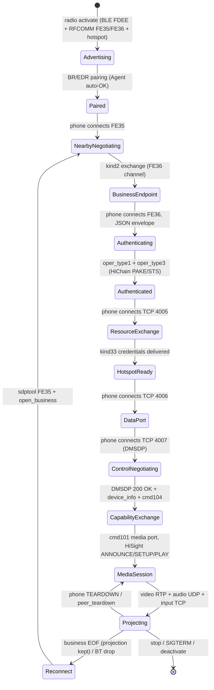

# HiCar 协议解析

> 依据：上游参考实现（Rust 编写的 Linux 无线 HiCar 接收端，全网唯一公开的 HiCar 车机端协议实现）。
> 本文件所有结论均引用源码文件与行号；源码无法确认的部分标注 **未验证/需实测**。
> 相关协议参考实现（独立 Python 复刻，用于验证 Rust 行为）位于 `tests/reference/`，文中一并引用。

## 0. 总体架构与连接时序（先建立全局图）

HelloCar 采用"一个 owner 进程 + 三个 worker 子进程"的模型（`src/hicar/cli.rs:72-79`）：

| 进程 | 模块 | 职责 |
| --- | --- | --- |
| owner | `backend.rs` | 全局调度：接收 RFCOMM/TCP 连接、路由帧、管理认证与生命周期 |
| radio-worker | `radio.rs` | BlueZ 蓝牙（BLE 广播、配对、RFCOMM 注册）、NetworkManager 热点 |
| session-worker | `session.rs` + `native.rs` | Nearby/Resource 协商、HiChain 认证（JNI 化后合并进主进程） |
| media-worker | `live.rs` | HiSight 媒体收发、AAC/PCM 编解码、输入回传 |

私有 IPC 用 `SOCK_SEQPACKET` socketpair + JSON（`backend.rs:157`、`tests/reference/rust_session.py:58-73`）。

**一次完整连接的电话时序**（依据 backend/session/radio 代码逻辑推断，电话侧行为标注未验证）：

```
华为/荣耀手机                    比亚迪车机（HelloCar）
   │  ① BLE 扫描到 ServiceData UUID=FDEE、LocalName=HelloCar 的广播   │
   │  ② BR/EDR 配对（Agent NoInputNoOutput 自动确认）                  │
   │  ③ 连 RFCOMM FE35（control，信道 23）                            │
   │  ── Nearby/CCMP 协商 + 业务端点交换 ──────────────────────────→   │
   │  ←─ 获得 FE36（business，信道 24） ──                             │
   │  ④ 连 RFCOMM FE36（business）                                    │
   │  ── JSON 信封 HiChain 认证（PAKE/STS，6 位 PIN） ──────────────→   │
   │  ⑤ 认证通过后，手机连 TCP 4005（Nearby）                          │
   │  ── ResourceManager：能力查询/业务请求/网络选择 ──────────────→    │
   │  ←─ 热点凭证（SSID/密码/5745MHz/端口/IP） ──                      │
   │  ⑥ 手机连接车机 5GHz 热点（HelloCar）                             │
   │  ⑦ 连 TCP 4006（Data）→ 获得控制端口 4007                         │
   │  ⑧ 连 TCP 4007（Control）→ DMSDP 协商/设备能力/服务发现            │
   │  ⑨ HiSight（RTSP over TCP，媒体端口由 DMSDP 下发）                │
   │  ── 视频 RTP(TCP) + 音频 RTP(UDP) + 输入回传(TCP) ──────────────→  │
```

端口拓扑（`backend.rs:234,272`，`radio.rs:376`）：

| 端口 | 信道 | 帧格式 | 用途 |
| --- | --- | --- | --- |
| base+0 = **4005** | `Kind::Nearby` | `Format::Nearby`（0x7F 帧） | Nearby 重协商 + ResourceManager（凭证下发） |
| base+1 = **4006** | `Kind::Data` | `Format::Module`（0x7F 帧） | 数据端口协商，返回控制端口 4007 |
| base+2 = **4007** | `Kind::Control` | `Format::Control`（0x00/0xAB 帧） | DMSDP 控制（文本消息 + 二进制消息） |

---

## 1. 发现层（Nearby / BLE）

### 1.1 广播内容格式

广播由 BlueZ D-Bus `LEAdvertisement1` 发布（`radio.rs:225`）：

```
Type: "peripheral"
Discoverable: true
LocalName: "HelloCar"
TxPower: 11（默认，`radio.rs:14`）
Instance: 0
ServiceData:
  UUID 0000fdee-0000-1000-8000-00805f9b34fb  →  [1,1,1,3, b0,b1,b2, 4, b3, 16, sequence]
```

- **ServiceData UUID**：`FDEE` = `0000fdee-0000-1000-8000-00805f9b34fb`（`radio.rs:12`）。这是华为 Nearby 服务的 128 位 UUID。
- **广播载荷** `beacon(model, sequence)`（`radio.rs:38`）：
  ```rust
  fn beacon(model:&str,sequence:u8)->Result<Vec<u8>>{
      let raw=super::unhex(model)?;            // model 是 8 位十六进制字符串 → 4 字节
      if raw.len()!=4{return Err(...);}
      Ok(vec![1,1,1,3, raw[0],raw[1],raw[2], 4,raw[3], 16, sequence])
  }
  ```
  即 11 字节载荷：`01 01 01 03 <b0> <b1> <b2> 04 <b3> 10 <seq>`。
  - `b0..b3` = model 的 4 字节解码值。model 是 8 位十六进制车型/车机标识（`radio.rs:30` 校验 8 位 hex；测试用例用 `"00040A00"`，`radio.rs:541` 附近）。
  - 第 11 字节 `sequence`：广播序列号，每次广播自增（`Radio` 状态，默认 1，`radio.rs:17`）。
  - 该载荷以 `ServiceData` 字典的字节数组下发（`Arg::Array("y", payload)`，`radio.rs:225`），即它是 **FDEE ServiceData 的值本身**，不是额外的 AD structure。
- **广播参数**：广告类型 peripheral、可发现、TX Power 11（`radio.rs:225`）。广播间隔/扫描响应未在源码中设置（BlueZ 默认；**未验证**手机是否读 Scan Response，Android 端由系统补 LocalName 即可）。

### 1.2 手机如何发现车机

源码是车机侧，手机侧发现逻辑不在本仓库。依据广播内容可推断（**未验证**）：华为手机 HiCar 扫描 BLE 广播，匹配 ServiceData UUID = FDEE 且载荷第 1-4 字节符合其车型识别格式的设备，读取 LocalName 作为显示名。Android 移植时只需原样构造 `AdvertiseData`（ServiceUuid FDEE + ServiceData + LocalName "HelloCar"），载荷按上述 11 字节格式构造。

---

## 2. 蓝牙配对与连接层（BR/EDR）

### 2.1 服务 UUID 与 RFCOMM 信道

（`radio.rs:10-11, 14, 386-387`）

| 服务 | UUID | 默认 RFCOMM 信道 | SDP 服务名 |
| --- | --- | --- | --- |
| control（profile） | `0000fe35-0000-1000-8000-00805f9b34fb` | **23**（`channel()`） | `NearbyServerSocket` |
| business | `0000fe36-0000-1000-8000-00805f9b34fb` | **24**（`channel+1`） | `NearbyBusinessSocket` |

注册参数（`radio.rs:387`）：`RequireAuthentication=false`、`RequireAuthorization=false`（认证在应用层 HiChain 做，不在蓝牙链路层做）。

### 2.2 SDP 服务记录内容

`service_record(channel, uuid)`（`radio.rs:39`）生成的标准 XML：

```
<record>
  <attribute id="0x0001">            <!-- ServiceClassIDList -->
    <sequence><uuid value="{uuid}"/></sequence>
  </attribute>
  <attribute id="0x0004">            <!-- ProtocolDescriptorList -->
    <sequence>
      <sequence><uuid value="0x0100"/></sequence>          <!-- L2CAP -->
      <sequence><uuid value="0x0003"/><uint8 value="{channel}"/></sequence>  <!-- RFCOMM -->
    </sequence>
  </attribute>
  <attribute id="0x0005"><sequence><uuid value="0x1002"/></sequence></attribute>  <!-- BrowseGroupList -->
  <attribute id="0x0100"><text value="NearbyServerSocket"/></attribute>          <!-- ServiceName -->
</record>
```

重连时对面通过 `sdptool search --bdaddr <addr> 0xfe35` 查询 SDP 拿到 RFCOMM 信道（`radio.rs:399`），解析出唯一一个 FE35 RFCOMM 信道（`radio.rs:42-55`）。**这证明手机侧也是通过 SDP 服务发现动态定位 FE35/FE36 的信道**——因此 Android 上用 `BluetoothServerSocket` 注册 FE35/FE36（信道由系统分配）与原实现兼容。

### 2.3 蓝牙 Agent 交互（配对）

（`radio.rs:249-250, 381`）

- 注册 **NoInputNoOutput** 为默认 Agent（`radio.rs:381`）。
- `RequestConfirmation` / `RequestAuthorization` → 自动接受（`radio.rs:249`）。
- `AuthorizeService` → 仅当 UUID 为 FE35/FE36 时接受，其余拒绝（`radio.rs:250`）。
- 控制器级设置：启动时读控制器信息（mgmt opcode 4），检查 bit4（bondable）与 bit1（connectable）；随后强制 `Set Bondable`（opcode 9，mask 16）与 `Set Connectable`（opcode 7，mask 2），退出时恢复（`radio.rs:383-386, 434, 467-473`）。
- 配对窗口 `--pair 5..120` 秒（`radio.rs:31`）；必须有 `--peer` 或 `--pair` 才能启动（`radio.rs:33`）。

> 关键结论：**BR/EDR 链路层配对是"免输入自动确认"**；真正需要用户输入的"连接码"是应用层 HiChain 的 **6 位 PIN**（见第 3 节），不是蓝牙 PIN。Android 车机普通 App 无法注册 NoInputNoOutput 默认 Agent（需系统权限），这是移植主要障碍之一（见移植设计文档 §2.3）。

### 2.4 认证前的数据交换

- 手机连 FE35（control）：`Format::Nearby` 帧（见 §4.1），先做 Nearby/CCMP 协商，再协商业务端点（FE36 信道）。
- 手机连 FE36（business）：`Format::Json`（增量 JSON 流，`backend.rs:188`），承载 HiChain 认证信封（见 §3）。
- **认证通过前**，TCP 4005/4006/4007 一律不接收（`backend.rs:273` 检查 `authenticated`）；认证通过后 `Resource` 才允许下发热点凭证（`session.rs:60-64`）。
- 重连场景：车机侧主动 `open_business(port)` 反向连接手机（`radio.rs:420-424`），对应手机已配对列表（`--peer`）。

---

## 3. 认证层（HiChain）

### 3.1 传输信封（business JSON 流）

每条消息是一个 JSON 对象（`session.rs:191-199`；`tests/reference/auth_wire.py:121-124,143-145`）：

```json
{"version":"A_0", "discover_type":1, "oper_type":1, "data":"<内层 JSON 字符串>", "usb_connection":false}
```

- **oper_type=1：身份握手**
  - 手机 → 车：`{"deviceId":"<64 hex>"}`（车存为 peer_id，`auth_wire.py:108-115`）。
  - 车 → 手机（`session.rs:191-192`）：
    ```json
    {"deviceId":"<本机线上身份>", "devicename":"HelloCar", "has_pin":true,
     "usb_connection":false, "CONNECT_ABILITY_KEY":"1", "CAR_MODE_ID":"<8 hex model>"}
    ```
- **oper_type=3：HiChain 原生报文**。`data` 为 deviceauth_lite 输出的 JSON 报文（PAKE/STS 消息），原样透传给 `libhellocar_hichain.so`（`session.rs:196-199`）；原生 `transmit` 回调产出的报文同样包回 oper_type=3 信封返回。

### 3.2 身份（auth id）与 PIN

- 本地持久身份 `identity.json`：随机 64 hex `device_id` + 固定 6 位数字 `pin` + 名称（默认 `HelloCar`）（`tools/identity.py:17-31,113`；`docs/usage.md:13-31`）。
- **线上身份**（wire identity）：`sha256(model.upper() + BR-MAC 去冒号大写).upper()`（`tools/identity.py:43-45`；`cli.rs:49,84`）。即同一辆车、同一蓝牙地址下线上身份稳定；换手机不影响 PIN。
- PIN 校验：必须 6 位 ASCII 数字（`identity.py:26`；`native.rs:149`）。

### 3.3 HiChain 握手流程（PAKE + STS）

车机作为 **server（role=2）**、手机作为 client（role=1）实例化（`native.rs:149,154`；`tests/reference/hichain.py:164-186`）：

| 步骤 | 方向 | 消息 | 说明 |
| --- | --- | --- | --- |
| 1 | 手机 → 车 | `PAKE_REQUEST`（`struct/pake_request.c`） | 携带 pake challenge / 素数群参数 |
| 2 | 车 → 手机 | `PAKE_RESPONSE`（`pake_response.c`；`pake_server.c: send_pake_start_response`） | server 公钥/挑战；`generate_pake_params` |
| 3 | 手机 → 车 | `PAKE_CLIENT_CONFIRM`（`pake_client_confirm.c`） | 客户端确认（基于 PIN 派生的共享密钥） |
| 4 | 车 → 手机 | `PAKE_SERVER_CONFIRM_RESPONSE`（`pake_server_confirm.c`；`pake_server.c: send_pake_end_response`） | 服务端确认；`generate_session_key` 派生会话密钥 |

- 四步消息码来自 `struct/parsedata.h`（`make_/parse_pake_request/response/client_confirm/server_confirm`）；调度在 `hichain.c` 的 `receive_data`/`navigate_message` 中按消息码路由。
- PAKE 之后进入 **STS**（可信会话）：`AUTH_START_REQUEST → AUTH_START_RESPONSE → AUTH_ACK_REQUEST → AUTH_ACK_RESPONSE`（`struct/auth_start_request.c / auth_start_response.c / auth_ack_request.c / auth_ack_response.c`；`key_agreement/sts_server.c / sts_client.c`）。STS 交换设备认证信息并确认派生密钥；`authenticate_peer()` 触发（`native.rs:163-178`；`hichain.py:263-267`）。
- **会话密钥**：初始 PAKE 绑定 `key_length=32`（`native.rs:150`）；后续 STS 按对端消息 17（`message==17`）中 `keyLength`（16 或 32）动态调整（`native.rs:178`；`hichain.py:249-255`）。密钥经 `SetKey` 回调交给上层（`hc_session_key`，≤128 字节），media worker 取前 16/32 字节作 AES-128-CTR 密钥（`live.rs:202`）。
- **HUKS 的角色**：会话密钥/长期密钥的存储与运算（`huks_lite`）。文件回调读写 `info1.data`、`info2.data`、`hks_keystore`（`native.rs:40`）；UDID 回调返回 `sha256(device_id)`（`tests/reference/hichain.py:88-89,156-160`）。认证存储目录默认 `/var/lib/hellocar/keys`（`backend.rs:96`）。
- **认证失败行为**：原生 `receive_data` 返回非 0 / `SetResult` 回错误码（`hichain.py:135-136` 检测 result=1 抛 `AuthError`）；此时 `authenticated` 保持 false，凭证不下发、TCP 不接受（`session.rs:60-64`、`backend.rs:273`）。**business 信道 EOF 不撤销已成功的投影**（`backend.rs:2` 注释）。

### 3.4 来源文件与函数（pinned 提交）

认证库来源（`native/sources.json:2-4`；`native/CMakeLists.txt:8-10`）：

| 组件 | 仓库 | pinned commit |
| --- | --- | --- |
| deviceauth_lite | `github.com/openharmony/security_deviceauth` | `552edb521d0bd7c17f2dab2791e7cdc3de284405` |
| huks_lite | `github.com/openharmony/security_huks` | `89f0842ef2600a0d9b5351ef11e1f8acab8ff439` |
| securec | `github.com/openharmony/third_party_bounds_checking_function` | `ebef58f44419d0694e984d25acac231e737d60ff` |

- 编译对象：`frameworks/deviceauth_lite/source/**/*.c` + `frameworks/huks_lite/source/hw_keystore_sdk/**/*.c` + `securec/src/*.c`（`CMakeLists.txt:11-13`）。
- 关键文件/函数：
  - `deviceauth_lite/source/hichain.c`：`get_instance`、`start_pake`、`authenticate_peer`、`receive_data`、`receive_data_with_json_object`、`destroy`、`navigate_message`、`init_center`。
  - `deviceauth_lite/source/key_agreement/pake_server.c`：`send_pake_start_response`、`send_pake_end_response`、`generate_pake_params`、`generate_session_key`、`parse_start_request_data`、`build_end_response_data`。
  - `deviceauth_lite/source/key_agreement/pake_client.c`：PAKE 客户端侧对偶函数。
  - `deviceauth_lite/source/key_agreement/sts_server.c` / `sts_client.c`：STS 四步。
  - `deviceauth_lite/source/struct/parsedata.h`、`pake_request.c`、`pake_response.c`、`pake_client_confirm.c`、`pake_server_confirm.c`、`auth_start_request.c`、`auth_start_response.c`、`auth_ack_request.c`、`auth_ack_response.c`：报文编解码。
  - `deviceauth_lite/source/huks_adapter/huks_adapter.c`：`cal_bignum_exp`（大素数模幂，PAKE 核心）、`generate_random`、`hks_hex_string_to_byte`；大素数常量 `g_large_prime_number_hex_348/256`。
  - `huks_lite/source/hw_keystore_sdk/soft_service/hks_storage.c`、`hks_file.c`、`hks_service.c`、`hks_rkc.c`：密钥存取/随机数。
  - `native/compat.c`：`ED25519_public_from_private`、`ED25519_sign`、`ED25519_verify`（用 OpenSSL EVP 补 deviceauth_lite 缺失的符号）、`carlink_abi_size`（ABI 守卫）。
- 外部依赖：`OpenSSL::Crypto` + `cjson` + `mbedcrypto`（`CMakeLists.txt:17-20,30`）；编译宏 `_CUT_LOG_`、`_POSIX_C_SOURCE=200809L`（`CMakeLists.txt:29`）。
- ABI 守卫：Rust 侧用 `libloading` 加载 `.so`，校验 6 个结构体大小（`native.rs:89-93`：`session_identity / hc_call_back / operation_parameter / hc_pin / hc_session_key / uint8_buff`）。

---

## 4. 会话层（DMSDP / Nearby / Resource）

### 4.1 Nearby 帧格式（Format::Nearby / Module）

（`tests/reference/nearby_wire.py:1-96`；`dmsdp_wire.py:19-23`）

```
帧 = 0x7F | kind(varint) | flags-TLV(tag=flags, len, options) | payload长度(varint) | payload | CRC16-ARC(LE)
```
- varint 为小端 base-128，bit7 标记最后字节；28 位上限；payload ≤65536。
- 与 protobuf 不同：**bit7=1 表示这是整数的最后一个字节**（`nearby_wire.py:23-31`）。
- `Format::Module`（数据信道）无 flags/options TLV：`0x7F | module(varint) | len(varint) | payload | CRC16`（`dmsdp_wire.py:19-23`）。

### 4.2 Nearby/CCMP 协商（Negotiator，`session.rs:80-130`）

- 帧 **kind=0**（CCMP 版本/加密协商），TLV 标签（`session.rs`）：
  - tag 1：CCMP 版本请求 → 回 tag 2 = `[2]`
  - tag 2：对端 CCMP 版本响应
  - tag 3：summary 交换 → 回 tag 4 = 自身 summary
  - tag 4：对端 summary
  - tag 5：加密偏好请求 → 回 tag 6 = `[0]`（不支持加密 Nearby）
  - tag 6：`[0]` 加密通道确认
  - `seen` 位掩码：1|2|4（版本+summary）置满即 complete（`session.rs`；`rust_session.py:104-107`）。
- 帧 **kind=2**：业务端点（business channel）协商。
  - 请求体（`session.rs:120-121`）：`uint(2) + uint(19) + uint(0) + uint(0)` = 业务 channel 请求。
  - 响应体（`session.rs` 附近）：`uint(0) + uint(channel) + 业务 tag + uint(0) + uint(16) + <FE36 UUID 16 字节>`；UUID 字节 `[0,0,0xFE,0x36,0,0,0x10,0,0x80,0,0,0x80,0x5F,0x9B,0x34,0xFB]`。
  - 车机作为被叫时回复业务信道 24；作为主叫（重连）时发 `open-business`（`backend.rs:290`）。
- 协商完成后在该信道上跑 ResourceManager（kind 4 / 33，见 §4.4）。

### 4.3 DMSDP 控制（Kind::Control，`dmsdp.rs`）

- **帧格式** `Format::Control`（`dmsdp.rs:14`；`control_wire.py:24-27`）：
  ```
  marker(1B) | length(2B BE) | payload
  marker = 0x00（明文）或 0xAB（加密）
  加密 payload = IV(16B) + AES-128-CTR(key, iv, plaintext)，key = 会话密钥前 16 字节
  ```
- **控制消息**：RTSP 风格文本，`\r\n` 分隔，`CSeq` 递增（`dmsdp.rs:9`）。支持：`OPTIONS * DMSDP/1.0`、`GET_PARAMETER * DMSDP/1.0`、`SETUP/PLAY/TEARDOWN * DMSDP/1.0`、`DMSDP/1.0 200 OK`。
- **加密协商**：
  - 车主动发 `OPTIONS`：`CryptoVer:1, CryptoAbility:222, CryptoAlg:aes128-ctr|null, UdpKA:0, LowDelay:0, CSeq:1`（`dmsdp.rs:157`）。
  - 手机 `SET_PARAMETER`：`CryptoVer:1, CryptoSwitch:222, CryptoAlg:<同值>, CSeq` → 车回 `200 OK {CryptoVer:1, CryptoSwitch:222, CryptoAlg, Platform:0}`，`negotiated=true`（`dmsdp.rs:219-222`）。
  - `CryptoSwitch:222` 是协议哨兵（0xDE），**不是**算法位掩码（`control_wire.py:188-191` 注释）。
- **心跳**：车发 `GET_PARAMETER * DMSDP/1.0 {CSeq:n}`，n 自 1 递增（`dmsdp.rs:158-161`）；手机发来的仅含 CSeq 的 GET_PARAMETER 视为保活（`dmsdp.rs:223`）。
- **时钟同步**：手机 `SET_PARAMETER {timeserverport, timeushigh, timeuslow, CSeq}` → 车回 200 OK 并记录 `(high<<32|low, 本地时刻, 端口)`（`dmsdp.rs:224-225`）。该时钟用于麦克风 RTP 时间戳（`uplink.rs:17-21`）。
- **二进制消息**（`dmsdp.rs:153-155`）：
  ```
  '$' | module(4B BE) | data_type(4B BE) | body长度(2B BE) | body
  ```
  - `module=5, data_type=0xFFFFFFFF`：HiSight 端点，body = `uint(101) + uint(port)` → 媒体 TCP 端口（`dmsdp.rs:191-192`）。
  - `module=3, data_type=0xFFFFFFFF`：设备信息/服务发现（见下）。

### 4.4 设备能力协商与热点参数下发

**设备信息**（`backend.rs:278`，车机在 Control 信道打开时上报）：
```json
{"deviceId":"<64hex>", "deviceName":"HelloCar", "deviceType":4,
 "bluetoothMac":"AA:BB:...", "btName":"HelloCar",
 "localIp":"192.168.49.1", "remoteIp":"192.168.49.2", "port":0,
 "properties":{"2003":"<model>", "5002":true, "5003":true, "5004":true, "5014":false}}
```

**服务发现**（module=3，cmd 104：mask 4 字节 BE；cmd 102：广播服务；`dmsdp.rs:199-203`）：

| 服务 | serviceId | serviceType | properties | 含义 |
| --- | --- | --- | --- | --- |
| 显示 | `display1` | 8 | `{"4001":1.0, "1009":800, "1010":480}` | 分辨率 800×480（CarDisplayCapability） |
| 扬声器 | `speaker1` | 4 | `{"2003":"48000,44100", "2004":"1", "2005":"12"}` | 支持采样率 |
| 麦克风 | `mic1` | 2 | `{"2003":"48000"}` | 上行语音 |
| 电话麦克风 | `modemMic` | 256 | 同上 | 通话上行 |
| 电话扬声器 | `modemSpeaker` | 512 | 同上 | 通话下行 |

**音频格式协商**（speaker1，`dmsdp.rs:103-107`）：手机 `SET_PARAMETER {AudioParameter: SampleRate=48000|44100|...;Format=16;ChannelNum=1|2;Codec=0}` → 协商为 **AAC-ADTS**（`codec:"aac-adts"`）。

**热点参数如何下发**——这是全协议最关键的字段（`session.rs:24`）：

```rust
fn credentials(&self)->Vec<u8>{
    format!("{}##{}\n{}\n{}\n5745\n1##version:3##{}##2##hicarApIp:{}",
            self.client, self.ssid, self.bssid, self.password, self.port, self.owner)
}
```

| 字段 | 值 | 含义 |
| --- | --- | --- |
| `{client}` | `192.168.49.2` | 手机 IP（client_ip） |
| `{ssid}` | `HelloCar` | 热点 SSID |
| `{bssid}` | 接口 MAC | 热点 BSSID |
| `{password}` | 32 位 hex | WPA2-PSK 密码 |
| `5745` | 5745 | 频点 MHz |
| `1##version:3##{port}##2##` | `1##version:3##4005##2##` | 版本/端口封装（4005 = base 端口，手机连 base+0/1/2） |
| `hicarApIp:{owner}` | `hicarApIp:192.168.49.1` | 车机 IP |

**下发通道**：ResourceManager 帧 kind=33 携带手机蓝牙 MAC → 车回 tag 3 = 上述凭证字符串（`session.rs:60-64`）。前提：`authenticated=true`、`negotiated=true`（`session.rs:29-32`）。
**手机侧消费方式**：源码为接收端，**未验证**。按凭证格式推断手机解析 SSID/BSSID/密码/5745MHz/端口/IP 后连接热点，再连 `base+0=4005`。移植时需实测手机对 SSID/信道/子网是否有硬性预期（见移植文档 §2.5 风险）。

**ResourceManager 帧**（`session.rs:40-70`）：

| 帧 kind | tag | 方向/内容 | 回复 |
| --- | --- | --- | --- |
| 4 | 1 | 能力查询（channel=3） | tag 2：`uint(3)+uint(1或255)+role[1,uint(5745)]`（接受条件：cap2=1、cap4=1、cap5&16≠0，`session.rs:44-46`） |
| 4 | 3 | 业务请求（channel=3、business=20、protocol=1 校验，`session.rs:51`） | tag 4：`uint(0)+uint(4006)+请求体回显`（data_port = offer.port+1，`session.rs:52,128`） |
| 4 | 7 | 网络选择 | 挂起 `(33, tlv(1,&[]))`，等手机 kind 33 |
| 33 | 1 | 网络命令（busy） | tag 2：`uint(0)` "busy" |
| 33 | 2/4 | 手机 MAC | tag 3：**凭证字符串** |
| 33 | 5 | 其它命令 | tag 6：空 |

### 4.5 数据端口协商（Kind::Data）

手机连 4006，发 `Format::Module` 帧：`module=1`、payload = 16 个零字节 → 车回：
`payload = [0x00] + (4007).to_be_bytes() + [0x00;13]`（共 18 字节：状态 0 + 控制端口 u32 BE + 13 个保留零）（`backend.rs:322`）。
（注：`tests/reference/dmsdp_wire.py:67-81` 的独立复刻为 2 字节端口；以 `backend.rs` 实际实现为准——18 字节、u32 端口。**需实测**确认手机按哪种解析。）

### 4.6 保活与断连

- DMSDP 心跳：车每 ~? 发 GET_PARAMETER（`dmsdp.rs:158-161`；backend 用 `last_heartbeat` 跟踪，`backend.rs:188`）。
- 未认证连接 30 秒无进展即关闭（`backend.rs:343`）。
- Nearby 解码器 CRC/格式错误 fail-closed 并复位（`nearby_wire.py:98-150`）。
- 视频背压触发 `link.recover()`（`live.rs:43-46,53`）。
- 断连清理：`stop_projection()`（`backend.rs:328`）→ media worker `stop_video()`（`live.rs:211`）→ 释放输入、清音频、session(false)。
- 业务信道 EOF 不撤销已成功投影（`backend.rs:2`）——即认证信道断开后媒体仍可持续（连接恢复走重连逻辑）。

### 4.7 状态机



---

## 5. 媒体层（HiSight）

### 5.1 HiSight 控制（RTSP over TCP，`hisight.rs`）

- **帧/记录格式**：`4 字节 BE 长度 + payload`（≤65000）；加密后 payload = `IV(16) + AES-128-CTR`（`hisight.py:27-29,74-84`；`hisight.rs` 同）。
- **加密协商**：车主动发 `ANNOUNCE * RTSP/1.0`，body = `encrypt_description: encrypt_list=aes128ctr;version=1\r\n`（明文，`hisight.rs:63`）；手机 `ANNOUNCE` 含 `aes128ctr` → 车回 `200 OK`，随后全加密（`hisight.rs:104-107`）。
- **OPTIONS**：手机 `OPTIONS` → 回 `Public: hisight1.0, GET_PARAMETER, SET_PARAMETER`；车再主动 `OPTIONS * RTSP/1.0 {Require: hisight1.0}`（`hisight.rs:109-111`）。
- **GET_PARAMETER（能力）**（`hisight.rs:117`）：
  ```
  his_version: 1.0
  his_video_formats: codecs 1;fps 30;gop 30;bitrate 2000000;vbr-min 1000000;vbr-max 3000000;
                     dpi 160;scr-w 800;scr-h 480;width 800;height 480
  his_audio_codecs: 1
  his_device_type: device_type 4;subtype 0;
  his_uibc_capability: input_category_list=GENERIC;
      generic_cap_list=left_point_down, left_point_up, left_move, left_key_down, left_key_up;
  ```
- **SET_PARAMETER**：`his_presentation_url` → 记录 RTSP target；`his_trigger_method: SETUP` → 车发 `SETUP {Transport: RTP/AVP/UDP;unicast;client_port=0}`（`hisight.rs:127-133`）；`TEARDOWN` → 置 peer_teardown。
- **SETUP 响应解析**：`Transport` 头中 `server_port=<媒体 TCP 端口>`、`remotectl_port=<输入 TCP 端口>`（`hisight.rs:141`）。随后车主动连这两个端口（`backend.rs:312` 连媒体端口；`live.rs:232-234` 连视频与输入端口）。
- **PLAY**：车主动 `PLAY`（`hisight.rs:156,71`）。
- **TEARDOWN**：车主动发，等 200 OK 确认（`hisight.rs:76`；`hisight.py:45-51`）。

### 5.2 视频流（H.264）

- **传输**：媒体 TCP 上每条记录 = `4 字节 BE 长度 + RTP 包`（`live.rs`；`hisight_media.py:70-72`）。
- **RTP 解包**（`media.rs:80-101`；`hisight_media.py:19-56`）：
  - RTP 头：version=2（`data[0]>>6==2`），payload type **96/97/98**（`media.rs:87`）。
  - 有扩展位时：PT=96 读 4 字节扩展头 + 长度；PT≠96 跳过 1 字节（`media.rs:92`；`hisight_media.py:32-38`）。
  - PES 重组：`00 00 01` 起始码 + PES 头（第 7 字节 `0x84`）+ `PES_packet_length`（0 或 =size-6）；解密从 PES 载荷偏移开始（`hisight_media.py:44-56`）。
  - **加密**：PES 载荷 = `IV(16) + AES-CTR(明文 ES)`，用会话密钥（`hisight_media.py:56`；`live.rs:247`）。
- **H.264 Annex-B 处理**（`live.rs:245-252`）：
  - `nal_units(data)` 按 `00 00 01`/`00 00 00 01` 切 NAL。
  - 关键帧判定：存在 NAL type 5（IDR）→ `key=true`（`live.rs:249`）。
  - 整帧 access unit（含 SPS/PPS/IDR 等全部 NAL）作为一条 kind=2 记录交给本地消费者（`live.rs:252`；`media-protocol.md:26-27`）。
  - **SPS/PPS**：不单独管理；手机在每个关键帧重复携带（依赖 gop 30）。解码器必须在关键帧上启动（`live.rs:52` wait_key）。
- **关键帧请求机制**：本地消费者发 `{"type":"keyframe"}` → `link.recover()`：丢弃排队视频、推送 kind=6 复位栅栏、置 `wait_key=true`，丢弃一切非关键帧直到下一个 IDR（`live.rs:302,43-46,52`）。**实现不向手机发送显式 FIR/PLI**——依赖手机周期性 IDR（gop 30）。移植时若手机长时间不重发 IDR，需实测是否需要 HiSight SET_PARAMETER 触发。

### 5.3 音频（下行：手机 → 车机）

- **传输**：UDP。手机向 speaker1/modemSpeaker 的 `server_port` 发送 RTP（`dmsdp.rs:89` 解析手机 `client_port=...--1;server_port=...` 得到对端端口；车机本地 UDP 端口由 `dmsdp-ports` 分配，`backend.rs:280`、`live.rs:220-223`）。
- **RTP**：PT=96，载荷为 **AAC-ADTS** 帧（`media.rs:5-33`：解析 ADTS 头得采样率表 `RATES[13]` 与声道 1/2）。去抖/重排：按 sequence 排序、容忍 16 包乱序、统计 lost/duplicates（`media.rs:35-64`）。
- **解码**：ffmpeg `aac → pcm_s16le 44100 立体声`（`live.rs:112`）；PCM 块固定 **3528 字节 = 882 采样 × 2ch × 2B = 20ms**（`live.rs:12,135`）；多流混合饱和（`live.rs:379`）。
- **本地交付格式**（Unix socket，kind 3）：`4B LE 长度 + [3, flags, 0, 0] + 8B LE pts + PCM`（`live.rs:35`；`media-protocol.md:9-36`）。

### 5.4 音频（上行：麦克风，手机 → 车机 → 网络）

- 车机采集 **16000Hz 单声道 s16le PCM**（`media-protocol.md:66`；`live.rs:50`）。
- ffmpeg 编码 **AAC 48000Hz 立体声 64kbps ADTS**（`uplink.rs:32`）。
- RTP：PT=96，**SSRC=1100**（`MICROPHONE_STREAM`，`uplink.rs:13`）；时间戳用同步时钟（手机时钟偏移 + 90kHz 采样率映射，`uplink.rs:17-21,66`）。
- 包格式：`0xAB + u16(16+len) + IV + AES-CTR(RTP)`，经 UDP 发给手机 mic 端点（`uplink.rs:68-69`；`live.rs:342`）。
- SSRC 低 12 位选择手机虚拟输入流 1100；**不要**用 DMSDP DataSessionID 替代（`media-protocol.md:74-75`）。

### 5.5 上行输入（触摸/按键）

- **通道**：HiSight `remotectl_port`（TCP）。
- **帧格式**（`tests/reference/hisight_input.py:22-26`；`live.rs` pack_input）：
  ```
  [0x00, 0x00] + u16 BE (16 + 6 + len(body)) + IV(16) + AES-CTR(6×0xFF + body)
  ```
  即 4 字节明文头（kind=0 + 长度=记录总长）+ 加密体（6 字节保留 0xFF + 事件体）。
- **触摸体**（`media.rs:73-75`）：
  ```
  [action, 0, 11, 1, 0, x:2BE, y:2BE, elapsed_ms:4BE, 0]   // 11 字节
  action: 0=按下, 1=抬起, 2=移动
  ```
  坐标范围 x<800、y<480（与 display1 能力一致，`media.rs:74`）。
- **按键体**（`media.rs:77-79`）：
  ```
  [3|4, 0, 9, 0, code:2BE, 0,0,0,0,0,0]                    // 11 字节；3=按下, 4=抬起
  ```
  键码：up=19, down=20, left=21, right=22, enter=23, back=4, home=3, play_pause=85, next=87, previous=88。
- **坐标归一化规则**（`live.rs:316`）：本地消费者给 0..1 归一化坐标 → `x*800, y*480` → `min(799)/min(479)` → 组包。Android 端触摸事件需按此规则映射（注意：**按 800×480 归一化，而不是按车机实际屏幕**；若投屏分辨率保持 800×480 则天然一致）。
- 本地消费者 → 车机的控制 JSON（kind 129）：`{"type":"touch","contacts":[...]}`、`{"type":"key-press","code":n}`、`{"type":"keyframe"}`（`media-protocol.md:40-60`）。

### 5.6 本地媒体协议（与消费者对接，移植时 Android 端替代物）

完整记录布局见 `docs/media-protocol.md:7-68`：

| kind | 方向 | 载荷 |
| --- | --- | --- |
| 1 | 车→消费者 | 配置：800×480×30（u32 LE ×3） |
| 2 | 车→消费者 | H.264 Annex-B 访问单元；flags bit0=关键帧 |
| 3 | 车→消费者 | PCM s16le 44100Hz 立体声，3528B/块；flags 0 媒体 / 3 通话 |
| 4 | 车→消费者 | 会话激活/停用（flags bit0） |
| 5 | 车→消费者 | 音频角色启停（1 字节 0/1） |
| 6 | 车→消费者 | 视频复位栅栏 |
| 7 | 车→消费者 | 麦克风配置 JSON（`generation/active/sample_rate=16000/channels=1`） |
| 129 | 消费者→车 | 控制 JSON（touch/key-press/keyframe） |
| 130 | 消费者→车 | 麦克风 PCM（8B LE generation + PCM） |

---

## 6. 关键硬编码清单

| # | 参数 | 值 | 位置 |
| --- | --- | --- | --- |
| 1 | FE35 UUID（control RFCOMM） | `0000fe35-0000-1000-8000-00805f9b34fb` | `radio.rs:10` |
| 2 | FE36 UUID（business RFCOMM） | `0000fe36-0000-1000-8000-00805f9b34fb` | `radio.rs:11` |
| 3 | FDEE UUID（BLE ServiceData） | `0000fdee-0000-1000-8000-00805f9b34fb` | `radio.rs:12` |
| 4 | BlueZ adapter 路径 | `/org/bluez/hci0` | `radio.rs:14` |
| 5 | RFCOMM 默认信道（control） | 23（business=24） | `radio.rs:14,386` |
| 6 | BLE TX Power | 11 dBm | `radio.rs:14,225` |
| 7 | BLE LocalName | `HelloCar` | `radio.rs:225` |
| 8 | beacon 载荷格式 | `[1,1,1,3,b0,b1,b2,4,b3,16,seq]` | `radio.rs:38` |
| 9 | model（车型 ID） | 8 位十六进制（如 `00040A00`） | `radio.rs:30`；测试 `radio.rs:541` |
| 10 | 热点 SSID | `HelloCar` | `radio.rs:352,376` |
| 11 | 热点频段 | `a`（5GHz） | `radio.rs:352` |
| 12 | 热点信道 | 149 | `radio.rs:352` |
| 13 | 热点频点 | 5745 MHz（等待就绪判定 `(5745 MHz)`） | `radio.rs:372,376` |
| 14 | 热点加密 | WPA2-PSK / RSN（`wpa-psk` + `proto rsn`） | `radio.rs:353` |
| 15 | 热点密码 | 随机 32 位 hex（16 字节） | `radio.rs:348,376` |
| 16 | 热点子网 | `192.168.49.0/24`（ipv4 shared，`192.168.49.1/24`） | `radio.rs:354,376` |
| 17 | 车机 IP（owner_ip） | `192.168.49.1` | `radio.rs:376`；`session.rs:22` |
| 18 | 手机 IP（client_ip） | `192.168.49.2` | `radio.rs:376`；`session.rs:22` |
| 19 | 子网前缀校验 | 必须 `192.168.49.x` | `session.rs:22` |
| 20 | base 端口（Offer.port） | 4005 | `radio.rs:376` |
| 21 | data 端口 | 4006（= base+1，offer.port+1） | `session.rs:128,167`；`backend.rs:234` |
| 22 | control 端口 | 4007（= base+2） | `backend.rs:234,322` |
| 23 | 凭证字符串模板 | `{client}##{ssid}\n{bssid}\n{password}\n5745\n1##version:3##{port}##2##hicarApIp:{owner}` | `session.rs:24` |
| 24 | PIN 位数 | 6 位 ASCII 数字 | `identity.py:26`；`native.rs:149` |
| 25 | HiChain package/service | `com.huawei.hicar` / `CarDevice` | `native.rs:153` |
| 26 | HiChain 角色 | 车=2（server），手机=1（client） | `native.rs:149,154`；`hichain.py:164` |
| 27 | 初始会话密钥长度 | 32 字节（PAKE），STS 16/32 | `native.rs:150,163,178` |
| 28 | HUKS 存储文件 | `info1.data` / `info2.data` / `hks_keystore` | `native.rs:40` |
| 29 | 认证库默认路径 | `/usr/local/lib/hellocar/libhellocar_hichain.so` | `backend.rs:96` |
| 30 | 认证存储默认目录 | `/var/lib/hellocar/keys` | `backend.rs:96`；`docs/usage.md:21` |
| 31 | 身份文件默认路径 | `/var/lib/hellocar/identity.json` | `identity.py:14`；`docs/usage.md:21` |
| 32 | AAC 解码器默认路径 | `/usr/bin/ffmpeg` | `backend.rs:96`（`audio_binary`）；`docs/usage.md:44` |
| 33 | DMSDP 加密算法/哨兵 | `aes128-ctr` / `CryptoSwitch:222` | `dmsdp.rs:157,220-222` |
| 34 | DMSDP 心跳起始 CSeq | 1 | `dmsdp.rs:142` |
| 35 | HiSight 记录上限 | 65000 字节 | `hisight.py:28-29`；`hisight.rs` 同 |
| 36 | HiSight 能力：分辨率 | 800×480 | `hisight.rs:117`；`dmsdp.rs:202` |
| 37 | HiSight 能力：帧率/GOP/码率 | 30fps / gop 30 / 2Mbps | `hisight.rs:117` |
| 38 | 视频 RTP payload type | 96/97/98 | `media.rs:87` |
| 39 | 本地 PCM 块 | 3528 字节（882 采样 ×2ch×2B，20ms） | `live.rs:12,135` |
| 40 | 本地 PCM 采样率/声道 | 44100Hz / 立体声 s16le | `live.rs:112,135`；`media-protocol.md:28` |
| 41 | 麦克风采集格式 | 16000Hz / 单声道 s16le | `live.rs:50`；`media-protocol.md:66` |
| 42 | 麦克风编码 | AAC 48000Hz 立体声 64kbps ADTS | `uplink.rs:32` |
| 43 | 麦克风 SSRC | 1100 | `uplink.rs:13` |
| 44 | 输入帧明文头 | `[0,0] + u16(len+4) + IV16 + CT(6×FF+body)` | `hisight_input.py:22-26`；`live.rs` |
| 45 | 触摸体 | `[action,0,11,1,0,x2,y2,elapsed4,0]`，x<800/y<480 | `media.rs:73-75` |
| 46 | 按键体 | `[3/4,0,9,0,code2,0;6]`；键码表 | `media.rs:77-79` |
| 47 | 触摸归一化目标 | ×800 / ×480，clamp 799/479 | `live.rs:316` |
| 48 | 配对窗口范围 | 5–120 秒 | `radio.rs:31` |
| 49 | 未认证 TCP 连接超时 | 30 秒 | `backend.rs:343` |
| 50 | 时钟同步超时 | 60 秒（RTP 时间戳有效窗口） | `media.rs:68` |

> 备注：`docs/usage.md:7` 明确说明 "SSID、信道 149/5745MHz、子网 192.168.49.0/24 目前定义在 `src/hicar/radio.rs`，未作为通用选项暴露"。以上清单即移植时需要参数化/回填的全部硬编码点。
