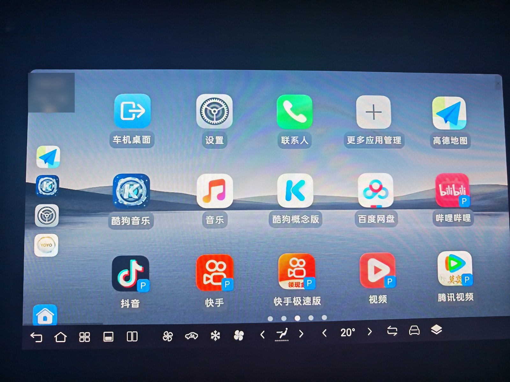
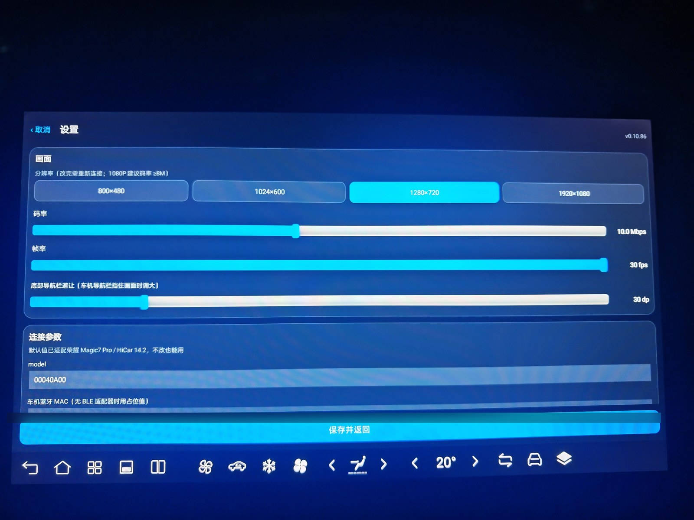

# HelloCar — Android 车机端 HiCar 无线投屏实现

用一台普通 Android 车机跑通华为 HiCar 的无线投屏全链路：蓝牙发现 → HiChain 认证 → 自建热点 → TCP 控制通道 → RTSP 协商 → RTP 视频 + UDP 音频 + RTCP 保活，最终在车机屏上出画面、出声音、能触摸。

项目不依赖华为官方 SDK / HiSight / DMSDP 授权库，全部基于公开协议时序 + 抓包分析自建实现。

> **当前版本：v0.10.86**（APK 约 10.4 MB，`arm64-v8a`，仅实机验证过比亚迪 DiLink 车机 + 荣耀手机）

---

## ⚠️ 免责声明

- 本项目是**协议研究 / 逆向工程实践**，用于学习车机互联协议栈的工作方式，不是华为官方产品，与华为无任何关系。
- **不得用于商业用途**，不得用于绕过任何设备授权、认证或安全机制后对外提供服务。
- 代码里使用的 DeviceAuth / HUKS 为 OpenHarmony 社区开源的 Apache-2.0 组件，**不是**从任何设备中提取的二进制。
- 认证过程需要手机端与车机端完成标准 HiChain PAKE 握手。**请在自己拥有的设备上测试。**
- 因使用本项目导致的设备异常、保修失效、数据丢失，作者不承担责任。

---

## 这是什么 / 不是什么

| 是 | 不是 |
| --- | --- |
| 一个可编译、可安装、可运行的 Android 车机 App | 华为官方 HiCar SDK 的替代品 |
| HiCar 无线投屏链路的完整复刻（认证 / 协商 / 媒体 / 输入） | 一键刷机包或系统级 Magisk 模块 |
| Rust 协议核心 + Kotlin 原生 UI 的混合工程 | 依赖系统签名的 privileged App |
| 面向逆向与协议学习的开源项目 | 开箱即用、全车型通用的商业方案 |

---

## 实机验证环境

只有在下面这套组合上做过实机验证，其他组合属于「理论可行、未验证」。

| 项目 | 实测值 |
| --- | --- |
| 车机 | 比亚迪海豹06 DiLink 车机（高通骁龙 8155 平台） |
| 车机系统 | Android（DiLink 定制 ROM），`targetSdk=28` 的应用可正常安装授权 |
| 手机 | 荣耀 Magic7 Pro |
| 手机系统 | MagicOS，HiCar 通道版本 `14.2.0.325`（系统通信通道 `13.2.0.400`） |
| 手机端 App | `com.hihonor.auto`（荣耀车联），`serviceType=CarDevice`，`version 2.0.15` |
| 无线 | 车机自建 `LocalOnlyHotspot`（5GHz / 5745MHz），手机作为 STA 接入 |

### 实机拍照

两张都是实机拍摄，左上状态栏与车机蓝牙 MAC 行已做打码。





### 适用条件（重要）

能不能跑，取决于车机是否同时满足这四条：

1. **Android 7.0（API 24）及以上**，且厂商 ROM 允许安装第三方 APK（有 `unknown sources` 开关）。
2. **支持 Bluetooth RFCOMM**：需要有 `BluetoothAdapter` 且能被其他设备搜索到（HiCar 走 SPP/RFCOMM 做发现通道）。蓝牙 MAC 在本项目里只能占位，真实 MAC 无法伪造，这决定了**发现阶段依赖手机主动发起**。
3. **支持 `LocalOnlyHotspot`**（API 26+）：车机要能自己开热点并回填 SSID / BSSID / 密码给手机。部分车机政策禁止开热点，会在这里失败。
4. **可以前台全屏 Activity + 自绘 Surface**：用于视频解码渲染，不需要 root。

不满足第 2、3 条的车机，基本无法走通。

---

## 架构

```
┌─────────────────────────── 车机（Android，arm64-v8a）───────────────────────────┐
│                                                                                │
│  Kotlin UI 层                                                                   │
│   MainActivity      主界面：PIN、启动/停止、日志（长按可复制）                    │
│   SettingsActivity  设置页：分辨率 / 码率 / 帧率 / 导航栏避让 / 连接参数          │
│   RenderActivity    投屏页：TextureView 渲染、触摸回传、音频焦点、退出回桌面       │
│   TcpServer / RfcommServer / HotspotManager   通道与热点                        │
│   MediaSession / MediaRenderer / AudioPlayer  媒体链路与解码                      │
│         │ JNI                                                                   │
│         ▼                                                                       │
│  Rust 核心（libhellocar_android.so，cdylib）                                     │
│   hicar/backend.rs     连接编排、通道打开、状态机                                 │
│   hicar/session.rs     控制面 TCP 4005/4006/4007，加密与分帧                      │
│   hicar/hisight.rs     HiSight RTSP 会话：ANNOUNCE / SETUP / PLAY / 参数协商      │
│   hicar/dmsdp.rs       设备虚拟化控制通道、音频/输入事件                          │
│   hicar/media.rs       RTP 视频 + UDP 音频 + RTCP 保活                            │
│   hicar/native.rs      HiChain 认证封装（deviceauth + HUKS 自编译）               │
│   hicar/json.rs        认证信封校验（operation / oper_type / deviceId）           │
│   hicar/identity.rs    本机身份、PIN、设备模型                                     │
│         │ dlopen                                                                 │
│         ▼                                                                       │
│  libhellocar_hichain.so  =  deviceauth(frameworks/deviceauth_lite)               │
│                             + HUKS(frameworks/huks_lite)                         │
│                             + securec + cJSON + mbedTLS + OpenSSL  → NDK 编译      │
└────────────────────────────────────────────────────────────────────────────────┘
                                   ▲ 蓝牙 / 5GHz 热点 / TCP / UDP / RTSP
                                   ▼
┌────────────────────────────── 手机（荣耀 MagicOS）──────────────────────────────┐
│  荣耀车联 com.hihonor.auto  → 蓝牙发现 → HiChain PAKE 认证 → 热点接入 →        │
│  TCP 4005/4006/4007 控制通道 → HiSight RTSP 协商 → RTP 推视频 / UDP 推音频      │
└────────────────────────────────────────────────────────────────────────────────┘
```

---

## 协议链路（按实际日志顺序）

1. **蓝牙发现**：手机通过 RFCOMM 连接车机的 SPP 通道，交换 `deviceId`、`serviceType`、`version`、能力表。
2. **身份握手（business 通道）**：手机下发 `oper_type=1` 的 JSON 信封，含 `has_pin` / `auto_connect_state` / `deviceId`。
   - `has_pin=true`：车机下 PIN，手机输 PIN 后走 `start_pake`（非可信模式，keyLength=32）。
   - `has_pin=false`：期望 `authenticate_peer` 在本地 keystore 查到配对凭据（**当前版本仍有待验证**）。
3. **HiChain 认证**：`oper_type=3` 信封双向传递挑战/响应包，`results` 含 `0` 表示成功，含 `1` 表示失败。
4. **热点**：认证通过后车机启动 `LocalOnlyHotspot`，把 `ssid / bssid / password / owner / client / freq / port` 回填给手机。
5. **控制通道**：手机连 `TCP 4005`（业务）、`4006`、`4007`，DMSDP 完成设备虚拟化（音频、输入、显示）。
6. **媒体协商**：`HiSight RTSP`（端口动态，实测 37119 一类），`OPTIONS → GET_PARAMETER（能力表）→ SET_PARAMETER → ANNOUNCE → SETUP → PLAY`。Transport 固定 `RTP/AVP/UDP;unicast;client_port=0`。
7. **媒体流**：视频走 RTP over TCP（4 字节长度前缀分片），音频走 UDP，`RTCP RR` 每 1000ms 保活。
8. **输入回传**：触摸/按键经 `nativeSendInput` 进 DMSDP 输入通道（当前为全局锁串行，见「已知问题」）。

---

## 快速开始

### 方式一：直接装 APK

1. 下载 [apk/HelloCar-v0.10.86.apk](apk/HelloCar-v0.10.86.apk)（10.4 MB，arm64-v8a）。
2. 车机允许未知来源安装，装上。
3. 打开 App → 填 PIN（与手机端一致）→ 点「启动」。
4. 手机端在「荣耀车联」里连接该车机；首次需输 PIN，之后尝试免 PIN（见 FAQ）。

### 方式二：从源码构建

先把 `HelloCar-HiCar-Android-v0.10.86-source.zip` 解压，后续命令都在解压出的 `HelloCar-HiCar-Android/` 目录里执行。

环境要求：

| 工具 | 版本 |
| --- | --- |
| Rust | 1.90+，target `aarch64-linux-android` |
| Android NDK | 26.3.11579264（`aarch64-linux-android24-clang`） |
| JDK | 17 或 21 |
| Gradle | 8.7（wrapper 已附带） |
| 系统 | Windows（脚本为 PowerShell；Linux/macOS 需自行改写路径） |

构建顺序（**必须先编认证库，再编 Rust 核心，最后打 APK**）：

```powershell
# 1) 认证库 libhellocar_hichain.so（deviceauth + HUKS + securec + cJSON + mbedTLS + OpenSSL）
#    依赖 native-compat/（跨平台补丁）与 third_party/openssl/arm64-v8a/libcrypto.a
pwsh -File .\build-android\build_auth_lib.ps1

# 2) Rust 核心 libhellocar_android.so
pwsh -File .\build-android\build_rust_core.ps1
#    成功标志：输出尾部 ==> done. Size: NNN bytes

# 3) APK
cd .\android-app
.\gradlew.bat assembleDebug
#    产物：android-app\app\build\outputs\apk\debug\app-debug.apk
```

产物校验：APK 内 `lib/arm64-v8a/libhellocar_android.so` 的 SHA256 应与 `jniLibs` 里那份一致。

---

## 目录结构

```
HelloCar-HiCar-Android/                               ← 本仓库根目录
├── README.md
├── LICENSE                     Apache-2.0
├── THIRD_PARTY_NOTICES.md      第三方组件许可汇总
├── HelloCar-HiCar-Android-v0.10.86-source.zip
│                               全部源码压缩包，解压后即下方结构
├── apk/
│   └── HelloCar-v0.10.86.apk   v0.10.86 构建产物（applicationId com.hellocar.car）
├── docs/
│   ├── protocol-notes.md       HiCar 协议抓包解析与键码表
│   ├── porting-design.md       车机移植设计（通道/端口/生命周期）
│   └── field-verification.md   实机验证操作手册
├── images/
│   ├── shot-hicar-home.jpg         实机：投屏后的车机桌面
│   └── shot-hellocar-settings.jpg  实机：设置页
├── rust-core/                  Rust 协议核心
│   ├── Cargo.toml
│   └── src/
│       ├── lib.rs
│       ├── jni.rs              JNI 入口（nativeFeed / nativeSendInput / nativeSetVideoParams…）
│       └── hicar/
│           ├── mod.rs  backend.rs  session.rs  hisight.rs  dmsdp.rs
│           ├── media.rs  native.rs  json.rs  identity.rs  crypto.rs
│           ├── live.rs  radio.rs  uplink.rs  wire.rs  cli.rs
├── android-app/                Kotlin UI 与媒体层
│   └── app/src/main/
│       ├── java/com/hellocar/car/*.kt
│       ├── res/layout/*.xml
│       ├── jniLibs/arm64-v8a/  （构建产物放这里：libhellocar_android.so）
│       └── AndroidManifest.xml
├── native-compat/              编译 hichain 所需跨平台补丁（compat.c / compat/*.h）
├── build-android/
│   ├── build_auth_lib.ps1
│   └── build_rust_core.ps1
├── third_party/                源码依赖（Apache-2.0 / MIT / BSD）
└──   deviceauth  huks  securec  cjson  mbedtls  openssl
```

---

## 已实现

- 蓝牙发现、身份握手、HiChain PAKE（PIN 模式 / 已配对模式两条入口）
- `LocalOnlyHotspot` 自建热点并回填真实参数
- TCP 4005/4006/4007 控制通道 + DMSDP 设备虚拟化
- HiSight RTSP 全流程：能力协商、SETUP/PLAY、teardown
- RTP over TCP 视频接收 + 分片重组 + `MediaCodec` 硬解 + `TextureView` 渲染
- UDP 音频接收 + ADTS 解析 + `AudioTrack` 播放 + 音频焦点让路
- 触摸 / 按键回传（含坐标投影与节流）
- 全屏沉浸式、按视频比例校正、退出回车机桌面
- 设置页：分辨率、码率（3–20 Mbps）、帧率、导航栏避让
- 日志落盘 + 主界面长按复制（车机文件管理器进不了私有目录，这是唯一取证途径）

## 已知问题

| # | 问题 | 现状与判断 |
| --- | --- | --- |
| 1 | **免 PIN 未验证成功** | PIN 输过一次后能连，但第二次是否还弹 PIN 未取得「认证段日志」证据。判定点：手机是否下发 `has_pin:false` + `authenticate_peer` 的 `results` 是否含 `0`。历史日志里 `identity.json` 的 mtime 长期不变，是「凭据未落盘」的间接信号。 |
| 2 | **帧率抖动** | 实测 fps 在 7.7–30 之间跳，队列积压恒为 1。RTP 缺口统计全程 `0 次 / 0 包`，证明**不是丢包**。根因是 `jni.rs` 一把全局 `Mutex` 同时供给视频喂帧与触摸发送，滑动时相互阻塞。 |
| 3 | **画面清晰度上限** | 源为 1280×720，车机屏远大于此，放大后偏软。1080p 试过，GPU 填充率不足（2.4fps）。 |
| 4 | **音频偶发加速 / 杂音** | ADTS 头已按流参数重建解码器与轨道（`48000Hz/2ch`），写入路径无失败记录，成因未定位，怀疑与路由切换/焦点抢占时序有关。 |
| 5 | **融合桌面不支持** | 手机端「桌面风格」选融合桌面时提示车机不支持。能力协商里手机请求 10 项，本项目只回复 5 项，`his_extended_field` / `his_media_capability` / `his_player_controller_capability` / `his_presentation_url` / `hn_magic_audio_enabled` 未回复；融合桌面字段的协议定义尚未取得。 |
| 6 | **回桌面路径不稳** | `finish()` 只弹掉投屏页会把用户落回本 App 主界面，已改 `finishAffinity()`；若仍失效，说明触发源是 HiCar 手机端下发的「回本机」控制事件，需在 DMSDP 侧解析。 |
| 7 | **无会话级自动重连** | 视频 EOF 后仅重连 3 轮，断开后需手动重启链路。 |
| 8 | **单车型验证** | 只在一台 DiLink 车机上跑通，其他车型的蓝牙/热点策略差异未覆盖。 |

---

## 后续改进（按优先级）

### P0 — 结构性问题，收益最大

1. **拆掉 JNI 全局锁**。把 `STATE: Mutex<Option<CoreState>>` 改成「引擎独占线程 + 两条无锁队列」：视频喂帧、输入发送各走一条队列，引擎单线程消费。这是帧率抖动与滑动卡顿的根因，改完 fps 应能稳定在源帧率附近。
2. **认证凭据持久化闭环**。在认证成功处打印 HUKS/keystore 目录的文件清单与 mtime，下次连接打印 `has_pin` 与 `authenticate_peer` 的 `results`，用两条日志把「免 PIN」从猜测变成可判定。
3. **能力表补全**，尤其是 `his_media_capability` 与 `his_extended_field`。融合桌面大概率在这里声明；但要先抓一台「原生支持融合桌面」的车机的应答做模板，盲填有让手机拒绝协商的风险。

### P1 — 体验与画质

4. **渲染路径零拷贝**。评估从 `TextureView`（多一层 GPU 合成）切到 `SurfaceView`（独立图层），并配合 `MediaCodec` 直接输出到 Surface；弱 GPU 车机上填充率是硬瓶颈。
5. **自适应码率**。用现有 fps 采样做闭环：连续 N 秒低于阈值就降码率，回升再逐步加，替代现在固定的 3–20 Mbps 区间。
6. **音频链路加固**。`AudioTrack` 换低延迟 buffer 配置、加写入欠载检测、按实测声道数重建（不轻信 ADTS 头），并对路由切换做忙等保护。
7. **会话状态机 + 自动重连**。把「连接 / 协商 / 播放 / 断开」做成显式状态，任一环节失败按状态回退重试，而不是整条链路重来。

### P2 — 工程化与生态

8. **兼容性矩阵**。整理「车机机型 / ROM / 蓝牙策略 / 热点策略 / 结果」表，把已知失败点前移到启动自检（现在就有一个自检页的雏形）。
9. **协议单测**。`json.rs` / `session.rs` / `hisight.rs` 的信封解析与状态迁移都可以脱离设备做单测，回归成本比实车低一个量级。
10. **安全与隐私**。PIN 与身份文件加密存储、日志脱敏（当前日志会打印 deviceId 与 PIN 相关字段，开源前建议加开关）。

---

## FAQ

**为什么每次还要输 PIN？**
免 PIN 的前提是：手机第二次下发 `has_pin:false`，且车机 `authenticate_peer` 能在本地 keystore 查出上一次配对写入的凭据。目前缺「认证段日志」来确认凭据有没有落盘，所以还不能断言是手机端还是车机端的问题。

**点「车机桌面」为什么回不到原生桌面？**
两条路径要分开看：本 App 的退出按钮 / 长按返回键走 `goHome()`（已改 `finishAffinity()` 关闭整个任务栈）；而 HiCar 界面里那个「回本机」图标是手机端下发的控制事件，需要车机在 DMSDP 侧响应，目前未实现。

**画面底部被车机导航栏压住怎么办？**
车机底部那排（返回/主页/多任务/空调/温度）是厂商自绘窗口，不是 Android 系统导航栏，`immersive` 隐藏不掉。设置页「底部导航栏避让」按像素压缩画面高度（横向铺满、纵向压缩到导航栏上方），调到刚好不遮挡即可，代价是画面纵向轻微压扁。

**能支持别的车型吗？**
理论上只要满足「可装第三方 APK + 有 RFCOMM + 能开 LocalOnlyHotspot」就可以，但没有验证过。欢迎提交兼容性报告（机型 / ROM / 卡在哪一步 / 日志）。

**为什么车机蓝牙 MAC 是占位值？**
蓝牙 MAC 在应用层无法真实伪造，公开实现只能占位，因此发现阶段依赖手机主动发起连接。

---

## 许可证

- 本项目代码：**Apache License 2.0**（见 `LICENSE`）。
- 第三方组件各自保留原许可证，详见 `THIRD_PARTY_NOTICES.md`：
  - Huawei DeviceAuth / HUKS / securec：Apache-2.0
  - cJSON：MIT
  - mbedTLS：Apache-2.0
  - OpenSSL：Apache-2.0（预编译 `libcrypto.a` 随包提供）

## 致谢

协议时序参考华为 HiCar 开发者文档的公开发布内容；`native-compat/` 的跨平台补丁沿用社区做法。感谢所有把抓包与失败日志留在公开渠道的人 —— 这个项目几乎每一处修复，都是从一份「连接失败」的日志里反推出来的。
